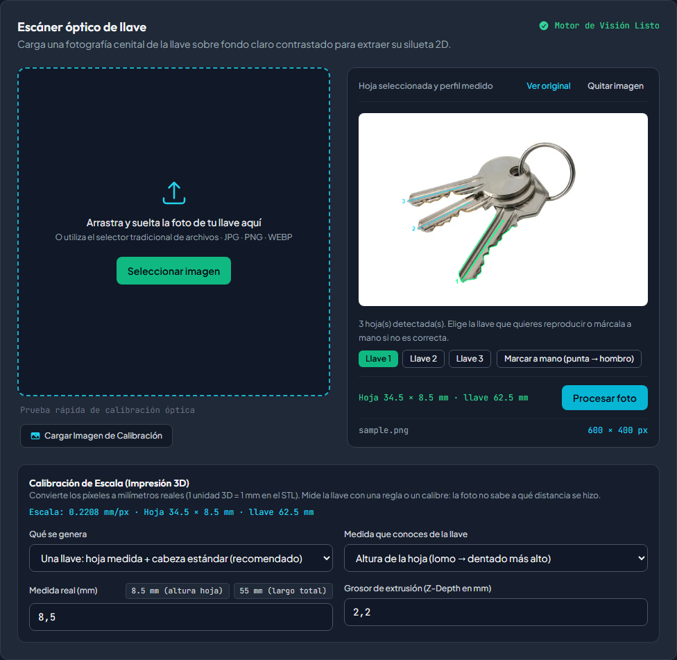
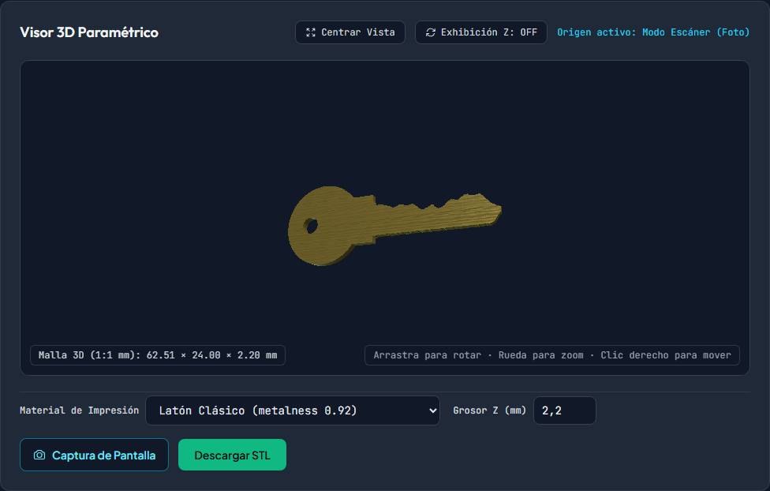
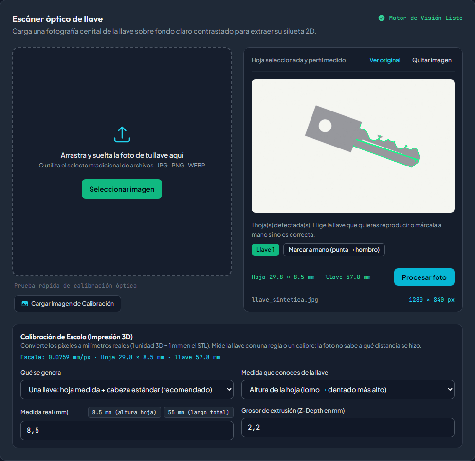
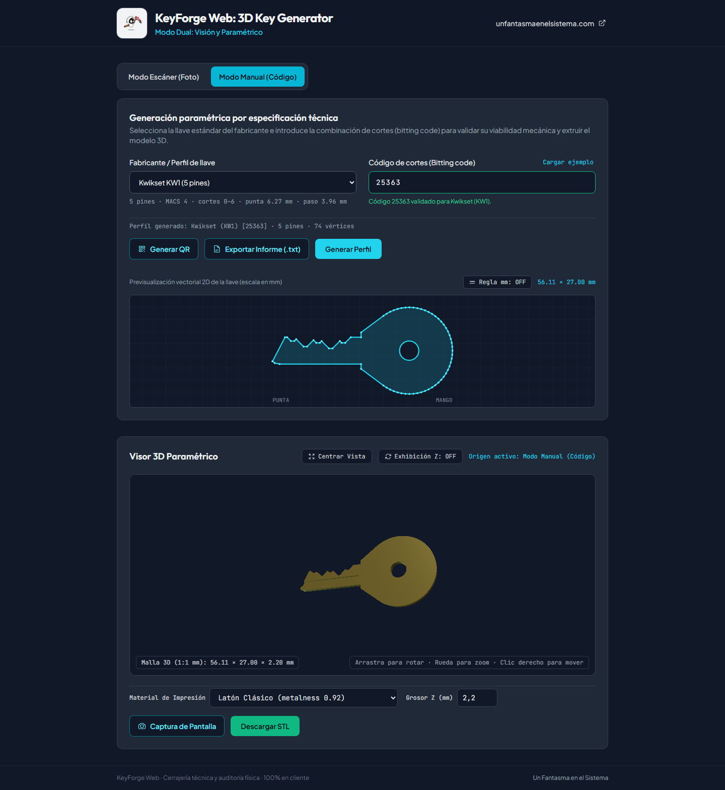
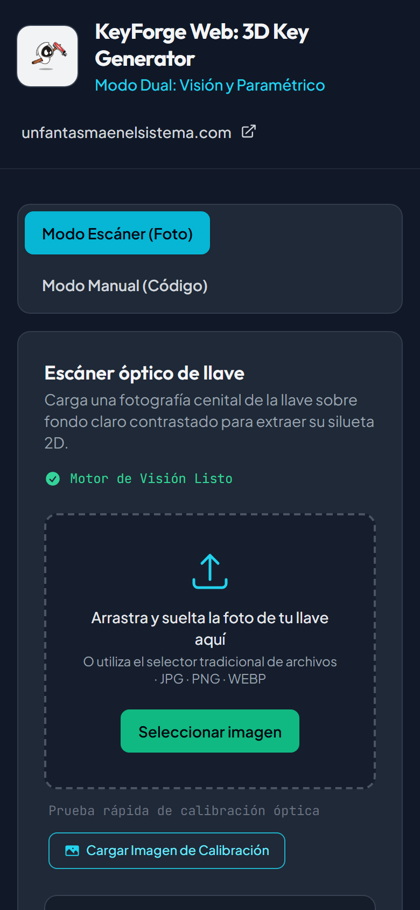

<p align="center">
  <a href="https://www.unfantasmaenelsistema.com/" target="_blank" rel="noopener noreferrer">
    
  </a>
</p>

# KeyForge Web: de la foto de una llave a un modelo 3D imprimible

Aplicación web **100 % en el navegador** (la foto no sale de tu equipo) que convierte la fotografía de una llave en un **modelo 3D listo para imprimir (STL a escala 1:1 mm)**. También genera llaves a partir de un **código de corte** de los perfiles más comunes. Usa **OpenCV.js** para la visión por computador y **Three.js** para el modelo 3D.

**[▶ Abrir KeyForge Web](https://unfantasmaenelsistema.github.io/KeyForgeWeb/)**

---

## Capturas de pantalla

> Capturas reales de la versión 2, tomadas sobre la compilación de producción.

### 1. Foto de un llavero: se detectan las hojas y se mide la elegida
La imagen de ejemplo (`sample.png`) tiene tres llaves y una anilla. KeyForge encuentra las tres hojas, descarta la anilla, mide el dentado de la llave elegida (en verde) y lo escala a milímetros con la altura de la hoja (8,5 mm por defecto).



### 2. Modelo 3D imprimible
Hoja medida en la foto + cabeza estándar con agujero para la anilla. La malla es estanca y se descarga en STL a escala real.



### 3. Foto propia de una sola llave
Funciona con la llave girada en cualquier ángulo y con brillos del metal.



### 4. Modo manual por código de corte
Perfiles Kwikset, Schlage, Best, Master Lock y Yale, con validación MACS, regla milimétrica, informe técnico y código QR.



### 5. Versión móvil


---

## Cómo sacar un buen STL de una foto

1. **Haz la foto desde arriba**, con la llave plana sobre un papel blanco o un fondo claro y liso, y buena luz sin sombras duras. Cuanto más perpendicular, menos se deforma la hoja.
2. **Carga la foto** (arrastrar, selector o el botón de la imagen de ejemplo) y pulsa **Procesar foto**.
3. **Elige la llave** si hay varias (botones *Llave 1, 2, 3…*). Si la detección no es buena, pulsa **Marcar a mano** y haz dos clics: primero en la **punta** de la hoja y después en el **hombro** (donde la hoja se une a la cabeza).
4. **Calibra con una medida real**, tomada con una regla o un calibre. La foto no sabe a qué distancia se hizo, así que esta medida fija la escala:
   - **Altura de la hoja** (del lomo al punto más alto del dentado). Es la opción más fiable.
   - **Longitud de la hoja** (del hombro a la punta).
   - **Largo total de la llave.**
5. Ajusta el **grosor** (2,2 mm por defecto), elige material y **descarga el STL**.

### Qué reproduce y qué no
- Reproduce el **contorno de la hoja**: dentado, punta y hombro, con la escala que le indiques. En una foto sintética con medidas conocidas, el dentado se recupera con un error medio de unos 0,1 mm.
- La **cabeza** es estándar (Ø 24 mm con agujero de 5 mm): la de la foto suele estar tapada por otras llaves o por la anilla y no influye en el funcionamiento.
- **No puede ver el perfil lateral** (los surcos longitudinales de la hoja). Una llave impresa plana no entra en un bombín con perfil de seguridad: sirve para estudiar, enseñar o hacer maquetas, o como base para tallar el perfil.
- El modo **Silueta completa** extruye el contorno exterior entero tal cual, para fotos de una sola llave tomada desde arriba.

---

## Funcionalidades

### Escáner (OpenCV.js + extractor de hojas)
- **Segmentación**: escala de grises, desenfoque gaussiano, umbral de Otsu y cierre morfológico. Los brillos del metal se rellenan, pero se respeta el interior de la anilla.
- **Detección de hojas** (`public/keyblade.js`): toma como posible punta cada punto extremo del contorno y sigue la hoja hacia dentro por los puntos medios de sus cortes, hasta el ensanchamiento del hombro. Descarta los trazos curvos o finos, como la anilla.
- **Medición del perfil**: cortes perpendiculares al eje que no saltan a una llave vecina. El borde dentado se coloca arriba y el lomo se endereza.
- **Escala** por altura de hoja, longitud de hoja o largo total. Las fotos grandes se procesan a 1.200 px de lado.
- **Marcado manual** con dos clics cuando la detección automática no basta.

### Modo manual (motor paramétrico y validación MACS)
- Rampa de entrada en la punta, cortes trapezoidales con ángulo de fresado y valle plano, topes de hombro y mango circular.
- Validación en tiempo real de la longitud del código, del rango de cada perfil y de la especificación **MACS** (*Maximum Adjacent Cut Specification*).
- Regla milimétrica 2D con el eje `0(H)` en el hombro y cotas por pin.
- Surco lateral fresado con CSG (`three-csg-ts`). La malla se suelda después para que el STL siga siendo estanco.

### Visor 3D y exportación
- Materiales PBR (acero, latón, aluminio, bronce y PLA), `OrbitControls`, centrar vista y rotación de exhibición.
- **STL** a escala `1 unidad = 1 mm`, listo para Cura, PrusaSlicer o Bambu Studio.
- Captura **PNG**, informe técnico **.txt** y **código QR** con la especificación (modo manual).

---

## Perfiles de fabricante incluidos (modo manual)

| Perfil | Pines | Rango de cortes | MACS | Distancia punta-pin 1 | Paso entre pines |
| :--- | :---: | :---: | :---: | :---: | :---: |
| **Kwikset (KW1)** | 5 | `0 – 6` | 4 | `6.27 mm` | `3.96 mm` |
| **Schlage (SC1)** | 5 | `0 – 9` | 7 | `5.87 mm` | `3.96 mm` |
| **Schlage (SC4)** | 6 | `0 – 9` | 7 | `5.87 mm` | `3.96 mm` |
| **Best SFIC (A2 System)** | 7 | `0 – 9` | 9 | `3.81 mm` | `3.81 mm` |
| **Master Lock (M1 / 1K)** | 4 | `0 – 7` | 5 | `5.50 mm` | `3.96 mm` |
| **Yale (Y1)** | 5 | `0 – 9` | 4 | `5.08 mm` | `4.19 mm` |

---

## Instalación y desarrollo local

Requisitos: **[Bun](https://bun.sh/)** (el proyecto usa `bun.lock`).

```bash
git clone https://github.com/unfantasmaenelsistema/KeyForgeWeb.git
cd KeyForgeWeb
bun install
bun run dev        # http://localhost:3000
bun test           # pruebas del extractor de hojas
bun run build      # genera ./dist
```

OpenCV.js (4.9.0) y Three.js (r128) se cargan desde CDN con la versión fija; Tailwind CSS se compila en el build.

---

## Despliegue en GitHub Pages

El flujo [`.github/workflows/deploy-pages.yml`](.github/workflows/deploy-pages.yml) se ejecuta en cada `push` a `main`. Instala con Bun (`bun install --frozen-lockfile`), pasa las pruebas, compila `./dist` y lo publica en https://unfantasmaenelsistema.github.io/KeyForgeWeb/ (en **Settings → Pages**, la fuente es **GitHub Actions**).

---

## Estructura del proyecto

```text
.
├── .github/workflows/deploy-pages.yml  # Pruebas, compilación con Bun y despliegue en Pages
├── docs/screenshots/                   # Capturas reales (PNG)
├── public/
│   ├── keyblade.js                     # Extractor de hojas: detección, medición y contorno imprimible
│   ├── sample.png                      # Foto de ejemplo (tres llaves y una anilla)
│   └── assets/logo.png                 # Logotipo
├── src/styles.css                      # Entrada de Tailwind CSS
├── tests/keyblade.test.js              # Pruebas con una foto sintética de medidas conocidas
├── index.html                          # Aplicación (UI, OpenCV.js, motor paramétrico y Three.js)
├── tailwind.config.js · postcss.config.js · vite.config.js
├── LICENSE                             # MIT
└── README.md
```

---

## Novedades de la versión 2

- **La foto de una llave ya genera una llave.** Antes el escáner extruía el contorno exterior más grande: con `sample.png` salía un bloque con las tres llaves y la anilla, escalado por el ancho de la imagen. Ahora aísla una hoja, mide su dentado y construye una llave imprimible.
- **Calibración real**: por altura de hoja, longitud de hoja o largo total. Antes se escalaba el ancho horizontal de la imagen, que en una llave girada no es ninguna medida.
- **Silueta completa alineada** con su eje largo antes de escalarla.
- **STL estanco**: el agujero de la cabeza dejaba triángulos duplicados y el surco CSG del modo manual dejaba uniones en T, así que los dos STL tenían aristas abiertas. Ahora el agujero es poligonal y la malla del CSG se suelda.
- **Despliegue reparado**: el workflow usaba la caché de npm sin `package-lock.json` y fallaba siempre. Ahora usa Bun, pasa las pruebas y publica.
- **Dependencias fijas**: OpenCV.js 4.9.0 en lugar de `4.x`, y Tailwind compilado en lugar del CDN de desarrollo.
- **Limpieza**: fuera el esqueleto de React sin uso y los restos de AI Studio.

---

## Uso responsable

KeyForge Web tiene fines educativos y de fabricación aditiva. Úsalo solo con llaves y cerraduras tuyas o con autorización expresa de su propietario. Copiar la llave de otra persona a partir de una foto sin su permiso puede ser delito.

---

## Licencia

Distribuido bajo licencia **MIT**. Consulta el archivo [`LICENSE`](LICENSE).
