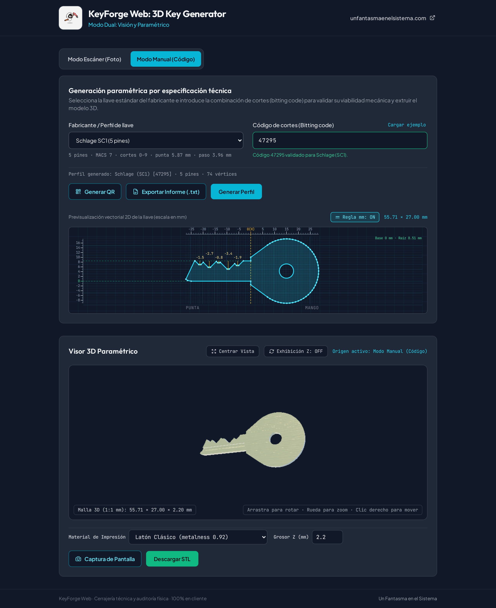
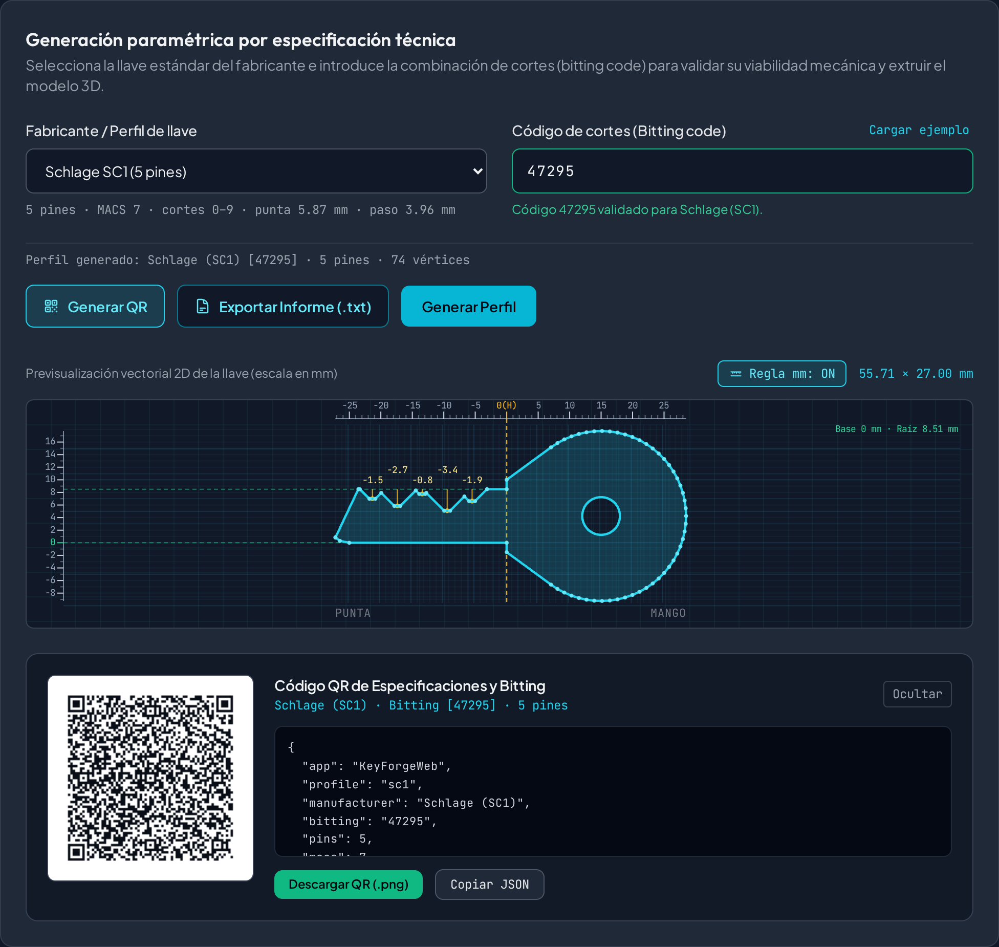
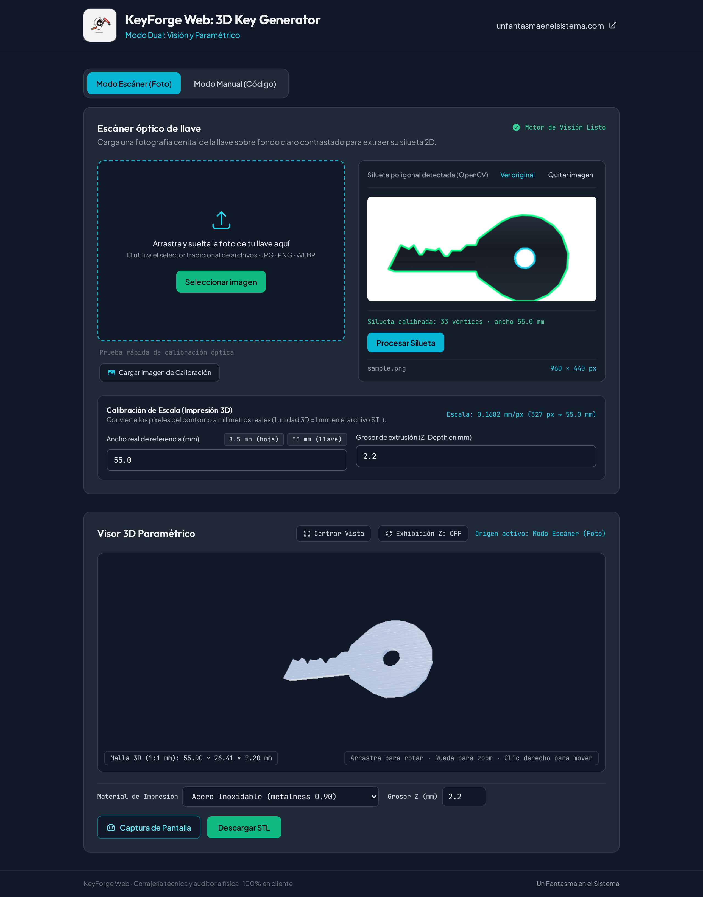

# KeyForge Web — Generador 3D de Llaves Paramétrico y por Visión Artificial

Aplicativo web **100 % client-side** (sin servidor ni envío de datos externos) para el diseño geométrico, calibración dimensional y exportación CAD/STL de modelos 3D de llaves, combinando **visión por computador (OpenCV.js)**, **modelado paramétrico CAD** y **renderizado WebGL PBR con operaciones booleanas CSG (Three.js)**.

---

## Capturas reales de la aplicación

### 1. Modo Manual Paramétrico, Regla Milimétrica 2D y Visor 3D PBR + CSG
Validación en tiempo real de restricciones mecánicas (MACS), perfil vectorial 2D con regla milimétrica referenciada al hombro `0(H)`, surco lateral fresado mediante CSG y renderizado metálico en **Latón Clásico**:



### 2. Transferencia por Código QR e Informe Técnico (`.txt`)
Generación instantánea de códigos QR con las especificaciones geométricas en JSON (descargable en PNG o copiable al portapapeles) y exportación de informes técnicos en texto plano:



### 3. Modo Escáner Óptico con OpenCV.js
Extracción automática del contorno exterior y del orificio del mango (`cv.RETR_CCOMP`) a partir de fotografías cenitales o de la imagen de calibración integrada (`sample.png`), con conversión píxel-a-milímetro para impresión 3D:



---

## Características principales

### Modo Escáner (Visión por Computador — OpenCV.js)
- **Carga flexible**: Arrastrar y soltar (`Drag & Drop`), selector de archivos (`JPG`, `PNG`, `WEBP`) o botón de prueba rápida con imagen de calibración integrada (`./sample.png`).
- **Pipeline de visión**: Conversión a escala de grises, desenfoque gaussiano, umbralización automática de Otsu, cierre morfológico y detección jerárquica de contornos (`cv.RETR_CCOMP`) para capturar tanto la silueta exterior como el orificio interior del mango.
- **Calibración dimensional 1:1 mm**: Escalado proporcional en milímetros reales con accesos rápidos (`8.5 mm` hoja / `55 mm` llave completa) y control de grosor de extrusión Z (`mm`).

### Modo Manual (Motor Paramétrico y Validación MACS)
- **Geometría realista**:
  - Rampa de ataque en la punta y chaflán inferior de entrada.
  - Cortes trapezoidales precisos con ángulo de fresado y valle plano según especificación.
  - Topes de hombro y mango ergonómico circular continuo generado por interpolación trigonométrica (`49` puntos).
- **Validación en tiempo real**: Comprobación de longitud exacta, rango permitido por perfil y especificación **MACS** (*Maximum Adjacent Cut Specification*).
- **Regla milimétrica 2D superpuesta**: Cuadrícula calibrada cada `1 mm` y `5 mm`, eje `0(H)` en el hombro, cotas de altura y profundidad de fresado por cada pin.

### Visor 3D WebGL, CSG y Materiales PBR
- **Fresado booleano CSG (`three-csg-ts`)**: Sustracción automática del surco lateral longitudinal (*warding*) a lo largo de la hoja antes de exportar la malla final.
- **Acabado metálico PBR procedural**: Mapas *normal map* y *roughness map* de metal cepillado generados por código sin dependencias de texturas externas, combinados con mapa de entorno de estudio (`PMREMGenerator`).
- **Selector de Material de Impresión**:
  - Acero Inoxidable (`metalness: 0.90`)
  - Latón Clásico (`metalness: 0.92`)
  - Aluminio Anodizado (`metalness: 0.82`)
  - Bronce / Cobre (`metalness: 0.90`)
  - PLA / Resina Prototipo (`metalness: 0.08`)
- **Controles de inspección**: `OrbitControls` con amortiguación, botón **Centrar Vista**, modo de **Exhibición Z** (rotación automática pausada al interactuar) y ajuste directo del grosor Z.

### Exportación e Interoperabilidad
- **Modelo 3D `.stl`**: Exportación directa en escala exacta `1 unidad = 1 mm` lista para laminadores de impresión 3D (Cura, PrusaSlicer, Bambu Studio, etc.).
- **Captura de pantalla `.png`**: Renderizado síncrono desde el canvas WebGL de Three.js.
- **Informe técnico `.txt`**: Resumen completo con parámetros del fabricante, dimensiones globales y tabla de profundidades de corte por pin.
- **Código QR (`.png` / JSON)**: Codificación de los cortes y parámetros geométricos para compartir entre dispositivos sin conexión.

---

## Perfiles de fabricante incluidos

| Perfil | Pines | Rango de cortes | MACS | Distancia punta-pin 1 | Paso entre pines |
| :--- | :---: | :---: | :---: | :---: | :---: |
| **Kwikset (KW1)** | 5 | `0 – 6` | 4 | `6.27 mm` | `3.96 mm` |
| **Schlage (SC1)** | 5 | `0 – 9` | 7 | `5.87 mm` | `3.96 mm` |
| **Schlage (SC4)** | 6 | `0 – 9` | 7 | `5.87 mm` | `3.96 mm` |
| **Best SFIC (A2 System)** | 7 | `0 – 9` | 9 | `3.81 mm` | `3.81 mm` |
| **Master Lock (M1 / 1K)** | 4 | `0 – 7` | 5 | `5.50 mm` | `3.96 mm` |
| **Yale (Y1)** | 5 | `0 – 9` | 4 | `5.08 mm` | `4.19 mm` |

---

## Instalación y desarrollo local

Requisitos previos: **Node.js 18+** y **npm**.

```bash
# 1. Instalar dependencias
npm install

# 2. Iniciar servidor de desarrollo (http://localhost:3000)
npm run dev

# 3. Compilar para producción (genera ./dist)
npm run build
```

---

## Despliegue en GitHub Pages

El repositorio incluye un flujo automático en `.github/workflows/deploy-pages.yml` configurado para compilar el proyecto con Vite (`base: './'`) y publicarlo en **GitHub Pages** en cada `push` a la rama `main`:

1. Sube este repositorio a GitHub.
2. Ve a **Settings → Pages** en tu repositorio.
3. En **Build and deployment → Source**, selecciona **GitHub Actions**.
4. Realiza un `push` a `main` o ejecuta manualmente el workflow **Desplegar KeyForge Web en GitHub Pages**.

---

## Estructura del proyecto

```text
.
├── .github/
│   └── workflows/
│       └── deploy-pages.yml   # Despliegue automático en GitHub Pages
├── docs/
│   └── screenshots/           # Capturas reales de la aplicación
├── public/
│   ├── .nojekyll              # Desactiva Jekyll en GitHub Pages
│   ├── assets/aistudio/       # Logotipo e icono de cabecera
│   └── sample.png             # Imagen de calibración óptica integrada
├── src/                       # Punto de entrada auxiliar Vite
├── index.html                 # Aplicación completa (UI, OpenCV.js, Motor Paramétrico y Three.js)
├── vite.config.ts             # Configuración Vite con base relativa ('./')
├── LICENSE                    # Licencia MIT
└── README.md
```

---

## Nota de uso responsable

KeyForge Web está diseñado con fines educativos, de ingeniería inversa geométrica, fabricación aditiva y evaluación técnica autorizada. Utiliza esta herramienta únicamente sobre llaves, cerraduras y prototipos de tu propiedad o bajo autorización expresa.

---

## Licencia

Distribuido bajo licencia **MIT**. Consulta el archivo [`LICENSE`](LICENSE) para más información.
